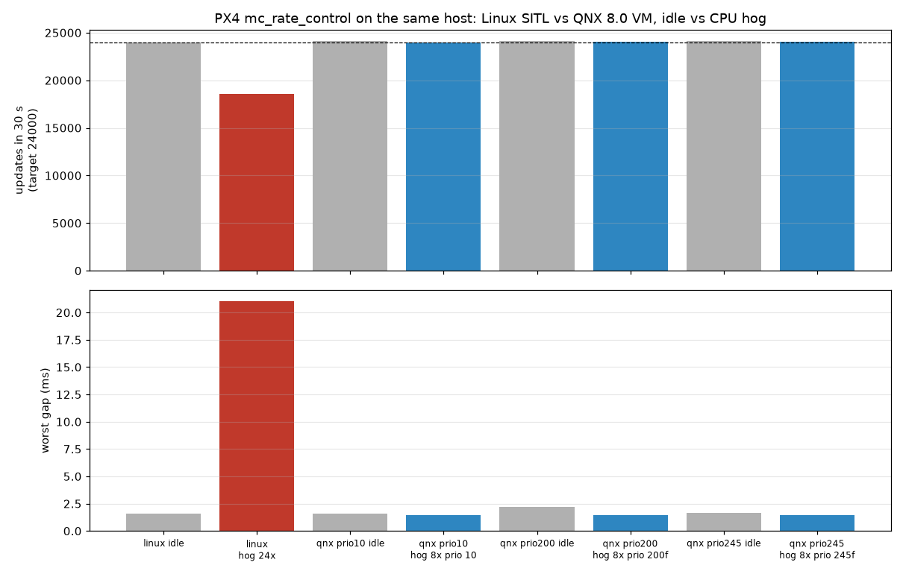

# px4-qnx

PX4 Autopilot ported to QNX 8.0. PX4 builds with `qcc`, runs in a QNX 8.0 QEMU x86_64 VM, flies a simulated quadcopter with PX4's built-in SIH simulator, and talks MAVLink to QGroundControl / MAVSDK on the host.

- Upstream: https://github.com/PX4/PX4-Autopilot, tag `v1.17.0` (BSD-3-Clause)
- Target: QNX SDP 8.0.5 (`QNX 8.0.0`), QEMU x86_64 with KVM, 4 vCPU, 2 GB
- Toolchain: `qcc` / `q++` 12.2.0 (`gcc_ntox86_64`), CMake + Ninja
- Demo video (2:21): https://youtu.be/ayAlSFN90dM
- This repo holds only our work: `patches/` on top of `v1.17.0`, scripts, tests, benchmarks, docs.

## Requirements

- Linux host with KVM and `qemu-system-x86_64`
- QNX SDP 8.0.5 at `~/qnx800` (override with `QNX_SDP`)
- An ssh key for the VM root login: `~/.ssh/id_ed25519_qnx` (+ `.pub`)
- CMake, Ninja, git, gcc (for the Linux baseline), [uv](https://docs.astral.sh/uv/)
- Optional: QGroundControl

## Build and run

```sh
scripts/fetch-upstream.sh      # PX4 v1.17.0 + submodules into ../work/PX4-Autopilot
scripts/apply-patches.sh       # git am patches/*.patch (branch qnx-port)
scripts/setup-venv.sh          # ../work/venv: PX4 codegen deps + mavsdk-grpc
scripts/build.sh               # qnx_sitl_default -> build/qnx_sitl_default/bin/px4 (QNX ELF)
scripts/make-vm.sh             # mkqnximage -> ~/qnx-vm-px4
scripts/run-vm.sh              # boot headless, ssh on localhost:2222
scripts/deploy.sh              # stripped px4 + ROMFS into /data/px4 in the VM
scripts/px4-vm.sh start        # PX4 SIH quad, MAVLink to the host at 10.0.2.2
scripts/vm-ssh.sh cat /dev/px4/state   # live state from PX4's QNX resource manager
```

MAVLink goes to the host: GCS link on UDP 14550 (QGroundControl), offboard link on UDP 14540 (MAVSDK, used by the tests). The automated tests cover 14540. QGroundControl v5.1.5 on 14550 was checked by hand: it connects with no setup and shows the test mission.

## Tests

```sh
tests/run-all.sh
```

| Test | Checks |
|---|---|
| `tests/test_boot.sh` | 20 SIH-flight modules running, rate/attitude/EKF loops > 100 Hz, `ver` reports QNX |
| `tests/test_priorities.sh` | every PX4 thread at priority 1..253, `wq:rate_ctrl` highest, work queues `SCHED_FIFO` and ordered |
| `tests/test_hrt.sh` | `hrt_absolute_time()` vs `CLOCK_MONOTONIC` over about 12 s: no backward steps, drift < 1 ms (consistency check) |
| `tests/test_params_persist.sh` | a parameter survives a PX4 restart |
| `tests/test_resmgr.sh` | `cat /dev/px4/state` (QNX resource manager in PX4): fields, live, read-only, server stays at fixed low priority even for a FIFO-200 reader |
| `tests/test_fault_isolation.sh` | mid-mission, a separate process hogs CPU + 512 MiB and segfaults, PX4 logger restarted: mission completes, PX4 untouched, core file written |
| `tests/test_flight.py` | MAVSDK: arm, takeoff 10 m, 10 s hold within ±1 m, 4-waypoint mission, land, disarm. Also passes on Linux SITL. |

## Results

See [docs/results.md](docs/results.md). Short version: with 2x-oversubscribed CPU load, stock Linux SITL (run as a normal user, so without real-time priorities; RT Linux not measured) lost 21% of rate-controller updates and had a 28 ms gap. On QNX the 800 Hz rate loop did not change. With the load at FIFO priority 200 the rate, attitude and EKF loops (239–253) were still unaffected, while lower-priority PX4 tasks (commander, navigator, MAVLink) were starved, exactly as strict priorities dictate.



Reproduce everything from an empty directory: `scripts/fresh-clone-test.sh`.

## Docs

- [docs/porting-notes.md](docs/porting-notes.md): every change, why, and every stub
- [docs/module-baseline.md](docs/module-baseline.md): what SIH flight needs, from Linux SITL
- [docs/architecture.md](docs/architecture.md): how PX4 maps onto QNX
- [docs/qnx-evidence.md](docs/qnx-evidence.md): QNX features used, with files and proofs
- Project site and codelabs: https://sarcastic-soul.github.io/px4-qnx/ (source `docs/index.html`, codelabs rendered by `codelab/build.sh`)
  - [Write a QNX 8.0 resource manager and control its priority](https://sarcastic-soul.github.io/px4-qnx/codelab-site/qnx-resmgr-priority/) (no PX4 needed; checked by `codelab/qnx-resmgr-priority/run-demo.sh`)
  - [Fly PX4 Autopilot on QNX 8.0 in QEMU](https://sarcastic-soul.github.io/px4-qnx/codelab-site/px4-sih-on-qnx/)
- Upstream: PR draft in [docs/upstream-pr.md](docs/upstream-pr.md). PR URL: _to be added_

## Known limits

- QNX normal timers round to the kernel tick; the VM boots with a 10 kHz tick (`procnto -C 10000`). With the default 1 kHz tick, loop jitter is about 6x higher.
- HAM (automatic process restart) is not in the QNX Everywhere image, so the fault test shows isolation, not restart.
- uXRCE-DDS (ROS 2 bridge) is not built on QNX.
- Only SIH simulation. No hardware drivers, no Gazebo.

## License

BSD-3-Clause, same as PX4. See [LICENSE](LICENSE).
