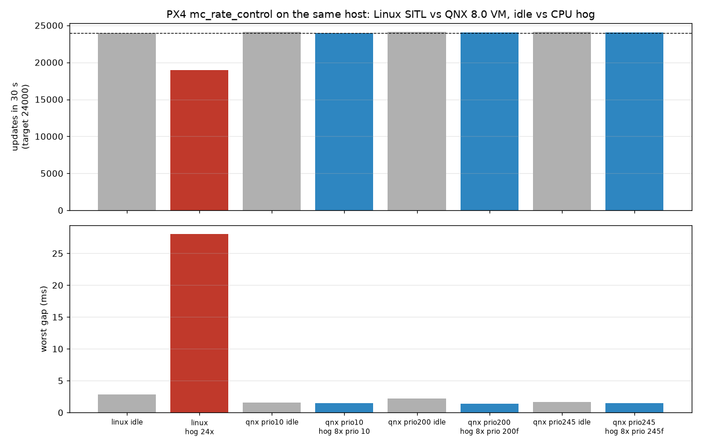

id: px4-sih-on-qnx
title: Fly PX4 Autopilot on QNX 8.0 in QEMU
summary: Build PX4 with qcc, boot it in a QNX 8.0 VM, fly a simulated quadcopter from QGroundControl, and see QNX priorities protect the control loop.
categories: robotics, porting, real-time
tags: intermediate
difficulty: 3
status: published
authors: Anish Kumar
feedback_link: https://github.com/Sarcastic-Soul/px4-qnx/issues


# Fly PX4 Autopilot on QNX 8.0 in QEMU

## Overview
Duration: 2:00

[PX4](https://px4.io) is an open-source flight controller used on drones, VTOLs and rovers. It normally runs on NuttX (flight boards) or Linux. In this codelab you run PX4 v1.17.0 on **QNX 8.0** inside a QEMU virtual machine and fly it with PX4's built-in **SIH** simulator.

### What you'll do
- Cross-compile PX4 with the QNX `qcc` toolchain
- Build and boot a QNX 8.0 x86_64 VM with `mkqnximage`
- Start PX4 in the VM and fly a mission from QGroundControl (or an automated MAVSDK script)
- Check PX4's thread priorities with `pidin`
- Load the CPU and watch the rate controller keep its 800 Hz
- Read live vehicle state from a QNX resource manager with `cat /dev/px4/state`

### What you'll need
- A Linux x86_64 host with KVM (`ls /dev/kvm`), 8 GB RAM, about 15 GB free disk
- QNX SDP 8.0 with a non-commercial QNX Everywhere license (see the [license codelab](https://qnx.github.io/codelabs/get-non-commercial-qnx-license/))
- `git`, `cmake`, `ninja`, `qemu-system-x86_64`, [uv](https://docs.astral.sh/uv/)
- Optional: [QGroundControl](https://qgroundcontrol.com)

All scripts used here are in the [px4-qnx](https://github.com/Sarcastic-Soul/px4-qnx) repo.

---

## Get the code
Duration: 10:00

Clone the port repo. It holds only patches and scripts. Upstream PX4 is fetched separately.

```bash
mkdir -p ~/px4ws && cd ~/px4ws
git clone https://github.com/Sarcastic-Soul/px4-qnx.git
cd px4-qnx
```

Fetch PX4 v1.17.0 with submodules (this takes a while), then apply the QNX patches:

```bash
scripts/fetch-upstream.sh     # -> ../work/PX4-Autopilot, branch qnx-port
scripts/apply-patches.sh      # git am patches/*.patch
```

Expected output ends with the five patch titles, for example:

```
posix: add QNX 8.0 toolchain, platform detection and qnx_sitl board
...
qnx: /dev/px4/state resource manager module
```

Create the Python environment PX4 uses for code generation:

```bash
scripts/setup-venv.sh
```

---

## Build PX4 for QNX
Duration: 10:00

PX4's code generators (uORB messages, parameters, MAVLink) run on the host with Python. Only the C/C++ is cross-compiled. `scripts/build.sh` sources `qnxsdp-env.sh`, points CMake at the QNX toolchain file, and builds the `qnx_sitl_default` board.

```bash
scripts/build.sh
```

Negative
: `qnxsdp-env.sh` only works in **bash**. The script runs it in bash for you. It also sets `TMPDIR` to `~/qnx-vm/.tmp`, because `qcc` writes large temp files and some hosts mount `/tmp` with a small quota.

At the end you should see a QNX binary:

```
build/qnx_sitl_default/bin/px4: ELF 64-bit LSB pie executable, x86-64, ...
  dynamically linked, interpreter /usr/lib/ldqnx-64.so.2, with debug_info
```

### What the patches change
PX4 already has a POSIX layer for Linux and macOS. The port adds a `__PX4_QNX` path to it:

| Area | Change |
|---|---|
| Build | `Toolchain-qnx-x86_64.cmake` (`qcc`/`q++`), link `libsocket` |
| Headers | QNX has `statvfs` but no `statfs`, and no `dirent::d_type`. Small wrappers cover both |
| Priorities | QNX 8.0 reserves priorities 254 and 255. PX4's maximum is capped at 253 |
| Threads | QNX threads **inherit** the creator's scheduling by default, so PX4 now sets `PTHREAD_EXPLICIT_SCHED` |

Positive
: Without the `PTHREAD_EXPLICIT_SCHED` fix, every PX4 work queue silently ran at the same priority (253). Always check with `pidin` after porting a threaded app to QNX.

---

## Build and boot the QNX VM
Duration: 8:00

`scripts/make-vm.sh` calls `mkqnximage` to build a QEMU x86_64 image with 4 vCPUs, 2 GB RAM, a 1 GB `/data` partition and your ssh key for root login.

```bash
ssh-keygen -q -t ed25519 -N '' -f ~/.ssh/id_ed25519_qnx   # skip if you have it
scripts/make-vm.sh
```

It also passes `-C 10000` to the kernel (`procnto`), which sets a 10 kHz system tick:

```bash
grep procnto ~/qnx-vm-px4/output/build/ifs.build
# ... procnto-smp-instr -mr -d 0777 -u 0777  -C 10000
```

Negative
: QNX 8.0 is tickless, but normal timers (`nanosleep`, condition-variable timeouts) still round to the tick. With the default 1 kHz tick, PX4's 800 Hz loop runs in 1 ms and 2 ms steps. 10 kHz removes most of that jitter.

Boot it headless and copy PX4 in:

```bash
scripts/run-vm.sh        # waits until ssh on localhost:2222 answers
scripts/deploy.sh        # stripped px4 + ROMFS -> /data/px4
scripts/vm-ssh.sh uname -a
```

```
QNX px4-qnx 8.0.0 2026/06/05-16:26:03EDT x86pc x86_64
```

The VM's root filesystem is a read-only boot image, so PX4 lives on `/data/px4`.

---

## Start PX4 on QNX
Duration: 3:00

```bash
scripts/px4-vm.sh start --clean
scripts/px4-vm.sh log | tail -5
```

```
INFO  [qnx_state_resmgr] serving vehicle state at /dev/px4/state
INFO  [px4] Startup script returned successfully
INFO  [commander] Ready for takeoff!
```

`px4-vm.sh` starts PX4 with `PX4_MAVLINK_PARTNER_IP=10.0.2.2`. That is the host as seen from a QEMU user-NAT guest, so MAVLink reaches the host with no port forwarding.

Run PX4 shell commands through the same script:

```bash
scripts/px4-vm.sh cmd commander status
scripts/px4-vm.sh cmd work_queue status
```

---

## Fly it
Duration: 5:00

### With QGroundControl
Start QGroundControl on the host. It listens on UDP 14550 and the vehicle appears within a few seconds. Arm, take off, upload a mission and fly it like any PX4 vehicle.

### Automated, with MAVSDK
```bash
../work/venv/bin/python tests/test_flight.py
```

```
[test_flight] armed
[test_flight] hold: 300 samples, alt min 9.95 max 10.10
[test_flight]   mission 4/4
[test_flight] landed
[test_flight] PASS
```

The script arms, takes off to 10 m, checks the hold stays within ±1 m, flies a 20 m square mission, lands and disarms.

---

## Look at the priorities
Duration: 3:00

```bash
scripts/vm-ssh.sh "pidin -p px4 -F '%h %p'"
```

```
wq:rate_ctrl          253f
:nav_and_controllers  240f
wq:INS0               239f
wq:hp_default         235f
logger                228f
wq:lp_default         203f
mavlink_rcv_if0       173f
commander             167f
log_writer_file        87f
```

`f` means `SCHED_FIFO`. The rate controller is at the top, then the attitude/position controllers and the EKF, with logging near the bottom. A normal QNX program (like your shell) runs at priority 10.

```bash
tests/test_priorities.sh
```

---

## Load the CPU
Duration: 5:00

Run 8 busy threads (2x the VM's CPUs) next to PX4 and measure the rate controller for 30 s:

```bash
bench/run_timing_qnx.sh                    # load at priority 10
HOG_PRIO=200f bench/run_timing_qnx.sh qnx-200   # load at FIFO priority 200
```

```
{"label": "qnx idle", "events": 24098, "avg_us": 1249.95, "max_us": 1566, ...}
{"label": "qnx hog 8x prio 10", "events": 24006, "avg_us": 1249.95, "max_us": 1438, ...}
```

The rate controller stays at about 24000 updates per 30 s (800 Hz) with or without the load. For comparison, `bench/run_timing_linux.sh` runs the same test against stock Linux SITL on the host. There it dropped to 18953 updates with a 28 ms gap. Unprivileged Linux SITL can't use real-time priorities, so this is not an RT-Linux comparison.



Try `HOG_PRIO=245f`. Now the load is **above** the EKF (239), and the script reports `ekf2 updates: ... hog 1`. Strict priorities do exactly what you set. Choosing them is a design decision.

---

## Read vehicle state from any QNX process
Duration: 3:00

The port adds a small PX4 module that is a QNX **resource manager**. It registers `/dev/px4/state` with the process manager, so any program can read live state with plain file I/O:

```bash
scripts/vm-ssh.sh cat /dev/px4/state
```

```
t_us=2112350094 armed=0 nav_state=4 x=-0.08 y=-0.07 alt=-0.29 vx=-0.05 ... battery=1.00
```

The core of it is a few calls:

```cpp
int chid = ChannelCreate(_NTO_CHF_FIXED_PRIORITY | _NTO_CHF_DISCONNECT | _NTO_CHF_UNBLOCK);
dispatch_t *dpp = dispatch_create_channel(chid, DISPATCH_FLAG_NOLOCK);
iofunc_func_init(_RESMGR_CONNECT_NFUNCS, &connect_funcs, _RESMGR_IO_NFUNCS, &io_funcs);
ocb_funcs.ocb_calloc = ocb_calloc;  // each open(): new OCB with a uORB snapshot
io_funcs.read = io_read;            // returns that OCB's snapshot as text
iofunc_attr_init(&attr, S_IFCHR | 0444, nullptr, nullptr);
resmgr_attach(dpp, &rattr, "/dev/px4/state", _FTYPE_ANY, 0, &connect_funcs, &io_funcs, &attr);
```

Positive
: By default, QNX message passing runs the server thread at the **client's** priority, so a real-time reader would lift it. `_NTO_CHF_FIXED_PRIORITY` turns that off: the server stays at 97, below every control loop. Check it with `on -p 200f cat /dev/px4/state` and `pidin -p px4 -F '%h %p' | grep qnx_state`.

---

## Break something
Duration: 4:00

```bash
tests/test_fault_isolation.sh
```

During a mission, this starts a separate process that takes 8 threads of CPU and 512 MiB of RAM and then segfaults. It also restarts PX4's logger in flight:

```
badapp: crashing now
Memory fault (core dumped)
rate controller while badapp ran: ~8000 events, 1249.8us avg
[test_flight] PASS
PASS: mission completed ... PX4 pid unchanged, core file written
```

The QNX `dumper` saved the crashed process's core in `/data/var/dumper`, ready for `ntox86_64-gdb`.

---

## Clean up and next steps
Duration: 1:00

```bash
scripts/px4-vm.sh stop
kill "$(cat ~/qnx-vm-px4/output/qemu.pid)"
```

You built PX4 with `qcc`, flew it on QNX 8.0, and saw strict priority scheduling, process isolation and a resource manager at work.

### Learn more
- `docs/porting-notes.md`: every change made for QNX and why
- `docs/results.md`: all measurements and how they were taken
- `bench/trace_ratectrl.sh`: capture a `tracelogger` kernel trace of the rate controller
- [QNX Programmer's Guide: Understanding the Microkernel's Concept of Time](https://www.qnx.com/developers/docs/8.0/com.qnx.doc.neutrino.prog/topic/timing.html)
