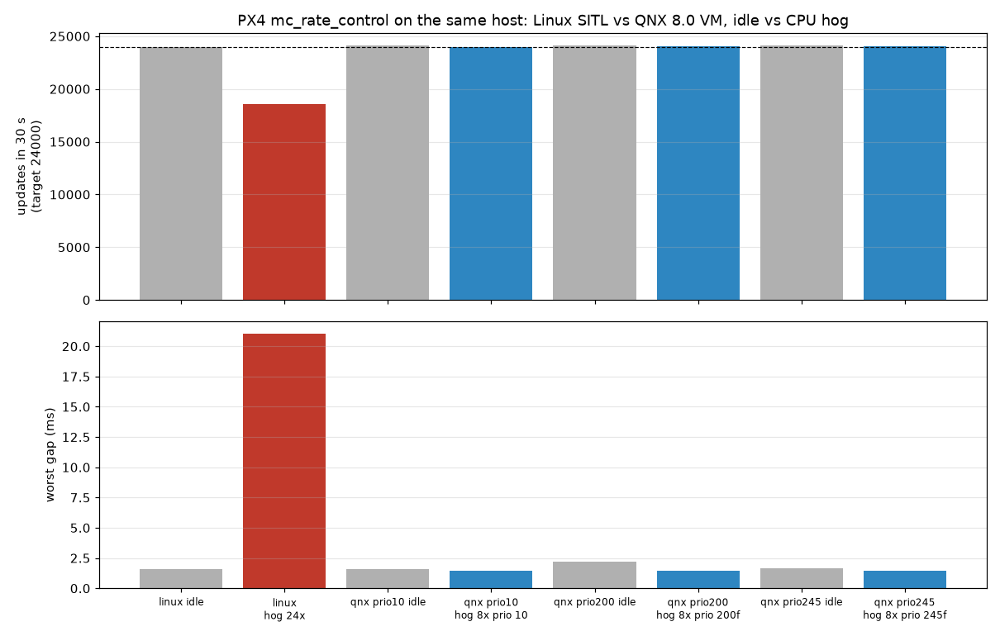

# Results

All numbers come from scripts in `bench/` and `tests/`, run on one host (12 CPUs, Linux, KVM). The QNX VM has 4 vCPUs and 2 GB, and its kernel runs with `procnto -C 10000` (10 kHz tick, set by `scripts/make-vm.sh`). VM timing includes host jitter, so only compare runs side by side. These are not absolute guarantees.

## 1. Control loop under CPU load

What is measured: time between `mc_rate_control` updates, from the PC_INTERVAL perf counter `mc_rate_control: interval` (patch 0004). Each phase lasts 30 s. Both sides run real-time (non-lockstep) SIH from the same PX4 v1.17.0 source. Target rate is 800 Hz (1250 us, 24000 updates in 30 s).

Scripts: `bench/run_timing_qnx.sh` (`HOG_PRIO=10|200f|245f`), `bench/run_timing_linux.sh`, plot `bench/plot_timing.py`. Raw output: `bench/results/`.



| Run | Updates in 30 s | Mean | Worst gap | Std dev |
|---|---|---|---|---|
| Linux SITL, idle | 24004 | 1250 us | 1.6 ms | 49 us |
| Linux SITL, 24 busy threads (2x host CPUs) | 18577 | 1617 us | 21.0 ms | 1476 us |
| QNX, idle | 24098 | 1250 us | 1.6 ms | 73 us |
| QNX, 8 busy threads (2x vCPUs) at prio 10 | 24006 | 1250 us | 1.4 ms | 51 us |
| QNX, 8 busy threads at prio 200 FIFO | 24037 | 1250 us | 1.4 ms | 50 us |
| QNX, 8 busy threads at prio 245 FIFO | 24015 | 1250 us | 1.5 ms | 51 us |

What this shows:

- Under load, Linux SITL lost 23% of rate-controller updates and had a 21 ms gap. Stock Linux SITL runs as a normal user, so PX4's `SCHED_FIFO` requests fail (`EPERM`) and its threads share the CPU with the load as equals.
- On QNX the update count and worst gap did not change under load. Even busy threads at FIFO priority 200 or 245 did not move the rate loop, because `wq:rate_ctrl` runs at 253.
- The flip side shows that priorities really are strict. At prio 245 the load sits above EKF2 (`wq:INS0`, 239): EKF2 ran 1 time in 30 s instead of about 2670. The run scripts log this (`ekf2 updates: idle 2677, hog 1`). On QNX the system designer picks who wins, and a wrong priority choice shows up right away.
- Kernel tick: with the default 1 kHz tick, QNX idle std dev was 440 us, because timers are rounded to 1 ms. With `-C 10000` it is 73 us, close to Linux. `procmgr_timer_tolerance()` and `TimerTimeout(TIMER_TOLERANCE)` did not change `usleep()`/condvar timeout granularity in our tests. Only the tick setting did.

Not measured: Linux SITL with real-time priorities (needs root). That would be the fairer "RT Linux vs QNX" comparison, and this table does not claim it.

## 2. Scheduler view from a kernel trace

`bench/trace_ratectrl.sh` records 2 s of QNX kernel trace with `tracelogger` (thread state events) and runs `bench/trace_latency.py`. For the `wq:rate_ctrl` thread, it pairs each THREADY event with the next THRUNNING event: the time the thread waited for a CPU after it became runnable.

| Phase | Runs per s | Ready-to-running median | p99 | max |
|---|---|---|---|---|
| idle | 1095 | 2.6 us | 11.0 us | 26.1 us |
| 8 busy threads at prio 10 | 842 | 2.7 us | 6.2 us | 16.5 us |

Under load, the rate-controller thread still gets a CPU within tens of microseconds of becoming ready. Runs per second differ between the phases because the thread also wakes for other work items on the same queue (control_allocator, pwm_out_sim), and how those wakeups get merged depends on timing. The per-update rate is the one in section 1. Raw traces stay in `../work/trace/` (not committed, 3 MB each).

## 3. Fault isolation

`tests/test_fault_isolation.sh`, during a full MAVSDK mission (`tests/test_flight.py`):

1. A separate process (`bench/badapp.c`) starts 8 busy threads, allocates and touches 512 MiB, then dereferences NULL.
2. PX4's logger module is stopped and started again in flight.

Result (last run): the mission completed and passed every flight assertion. PX4's process id was unchanged. The bad app exited with `Memory fault (core dumped)` and the QNX `dumper` wrote its core file to `/data/var/dumper`. The rate controller ran 8470 times at 1250 us mean while the bad app was alive.

This shows the process model (separate address spaces, crash contained, core captured for analysis), not anything PX4-specific. HAM (QNX High Availability Manager) is documented in the SDP but not shipped in this image, so automatic restart is not shown.

## 4. QNX resource manager

`qnx_state_resmgr` (patch 0005) is a PX4 module that registers `/dev/px4/state` with the QNX process manager. Any QNX process can then read live vehicle state with plain `open()`/`read()`:

```
# cat /dev/px4/state
t_us=2112350094 armed=0 nav_state=4 x=-0.08 y=-0.07 alt=-0.29 vx=-0.05 vy=-0.04 vz=-0.00 heading_deg=0.1 pos_valid=1 battery=1.00
```

QNX message passing runs the server thread at its client's priority (we measured prio 10 for a normal shell, 60 for `on -p 60 cat`). So a reader cannot push it above the control loops. `tests/test_resmgr.sh` checks the fields, that the timestamp advances, that the device is read-only, and the thread priority. `tests/test_hrt.sh` also uses it to compare PX4's clock with `CLOCK_MONOTONIC` (drift 10–98 us over 12 s in three runs).
